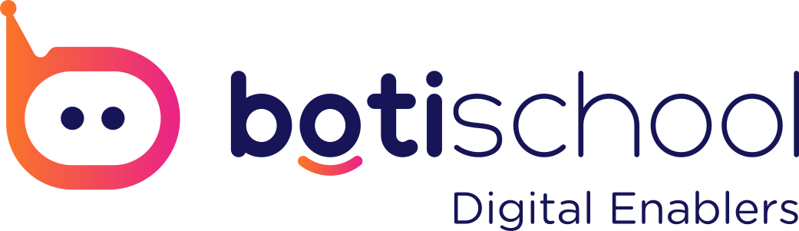

# Design system BOTI « Lumière »

Charte de l'interface des outils internes BOTI (Import EDT, BOTI Hub, CRM). À appliquer telle quelle sur tout nouveau projet : n'inventez pas d'autre palette, police ou style. Si un besoin n'est pas couvert, déduisez-le de ces règles et signalez-le.

Interface en français. Code, noms de fichiers et commits en anglais.

## Logo

Le logo officiel « botischool · Digital Enablers » est un SVG, avec un dégradé #FB7725 → #EA2287 et du texte bleu nuit #171557.

| Fichier | Usage | Hauteur |
|---|---|---|
| `brand/boti-logo.svg` | Logo complet, barre du haut | 34 px bureau, 28 px mobile |
| `brand/boti-mark.svg` | Symbole seul, icône d'onglet | 32 px |

**Où récupérer les fichiers :**

- **Avec ce document :** les deux SVG sont livrés à côté, dans le dossier `brand/`.
- **Dans le CRM BOTI :** https://claude.ai/artifact/Cy1yEUWuFuJcCL9vPEDubW, fichiers `brand/boti-logo.svg` et `brand/boti-mark.svg`. Ce lien est privé : il faut un compte autorisé pour l'ouvrir.
- **Dans le dépôt du BOTI Hub :** `apps/web/public/brand/boti-logo.svg` et `apps/web/public/brand/boti-mark.svg`.

**Règles d'usage :**

- Ne jamais redessiner, recolorer ni déformer le logo. Gardez ses proportions avec `height` fixe et `width: auto`.
- À côté du logo, le nom de l'outil va dans une pastille : fond #EFEEFD, texte #2B28DE, 12 px, graisse 600, coins arrondis complets.
- Dans une page autonome sans fichiers annexes, intégrez le SVG en data URI base64 plutôt qu'en lien.

```html
<div class="brand">
  
  <span class="tool-pill">Nom de l'outil</span>
</div>
```

## Typographie

- **Police :** Outfit (Google Fonts), graisses 400, 500, 600, 700 et 800. Repli : `system-ui, -apple-system, 'Segoe UI', sans-serif`.
- **Chiffres :** `font-variant-numeric: tabular-nums` partout où des nombres s'alignent.

```html
<link rel="preconnect" href="https://fonts.googleapis.com">
<link rel="stylesheet" href="https://fonts.googleapis.com/css2?family=Outfit:wght@400;500;600;700;800&display=swap">
```

| Élément | Taille | Graisse | Détails |
|---|---|---|---|
| Titre de page (h1) | 40 px, 32 px mobile | 800 | Interligne 1.05, lettrage -0.03em, un mot en dégradé signature |
| Surtitre au-dessus du h1 | 13 px | 500 | #5D6C9F |
| Phrase de résumé sous le h1 | 15 px | 400 | #5D6C9F |
| Titre héros (accueil, connexion) | 56 px, 40 px mobile | 800 | Lettrage -0.035em |
| Titre de carte (h2) | 18 px | 700 | |
| Titre de fenêtre | 22 à 28 px | 700 | |
| Texte courant | 15 px | 400 | Interligne 1.5 |
| Libellé de champ | 13 à 14 px | 600 | Toujours au-dessus du champ |
| Aide, métadonnées | 13 px | 400 | #5D6C9F |
| Pastilles, badges | 12 px | 600 | |
| En-têtes de tableau | 12 px | 600 | Majuscules, lettrage 0.04em, #8892B8 |

## Couleurs

| Rôle | Valeur | Jeton |
|---|---|---|
| Texte principal, titres | #0C0C5E | `--foreground` |
| Texte secondaire | #3B4A7A | `--ink-2` |
| Texte discret, légendes | #5D6C9F | `--muted-foreground` |
| Libellés de groupe, en-têtes de tableau | #8892B8 | `--ink-3` |
| Accent (liens, élément actif, cases cochées) | #2B28DE | `--primary` |
| Fond doux de l'accent | #EFEEFD | `--secondary` |
| Violet de précision | #F6F5FE | `--precision` |
| Fond de page | #FCFCFD | `--background` |
| Cartes, barres, fenêtres | #FFFFFF | `--card` |
| Zones neutres (recherche, survol) | #F7F7FB | `--muted` |
| Bordures | #ECEEF6 | `--border` |
| Bordures de champs | #DCE0EE | `--input` |
| Filets internes | #F1F2F8 | `--hairline` |
| Anneau de focus | #8A3CF9 | `--ring` |

### États

Chaque état a une couleur de texte, une couleur de fond et une couleur de point.

| État | Texte | Fond | Point ou bordure |
|---|---|---|---|
| Succès, actif | #00706A | #E2F5F3 | #1D9E75 |
| Information, en cours | #0058B0 | #E8F2FF | #378ADD |
| Alerte, à vérifier | #9A4A00 | #FFF2E3 | bordure #F2D3A8 |
| Danger, destructif | #B5104E | #FDE7EF | |
| Neutre, désactivé | #4A5578 | #EEF0F6 | #A7AECB |

### Dégradés

Les dégradés sont la signature visuelle. Utilisez-les avec parcimonie.

| Dégradé | Valeur | Usage |
|---|---|---|
| Action | `linear-gradient(90deg, #FF6A1A 0%, #FF2D3A 55%, #FF0A8A 100%)` | Bouton principal uniquement, un seul par zone |
| Signature | `linear-gradient(90deg, #FF009D 0%, #8A3CF9 50%, #0A7CFF 100%)` | Un ou deux mots des grands titres ; avatars à 135deg. Jamais un paragraphe entier |
| Lumière | `linear-gradient(180deg, #EFEEFD 0%, #F6F5FE 240px, #FCFCFD 560px)` | Fond de page, accueil, connexion, états vides |
| Logo | #FB7725 → #EA2287 | Uniquement dans le SVG du logo |

### Familles d'applications

| Famille | Couleur |
|---|---|
| CSM | #FF2D3A |
| CS tools | #8A3CF9 |
| Product enhancement | #0A7CFF |

### Graphiques

Couleurs des séries, dans cet ordre : #2B28DE, #FF2D3A, #8A3CF9, #0A7CFF, #FF6A1A, #1D9E75. Grille #ECEEF6, libellés #5D6C9F.

## Formes et espacements

| Élément | Valeur |
|---|---|
| Rayon des champs et boutons | 12 px (10 px pour les petits boutons) |
| Rayon des cartes et blocs | 20 px |
| Rayon des indicateurs (KPI) | 18 px |
| Rayon des fenêtres et volets | 24 px |
| Rayon des menus | 14 px |
| Rayon des pastilles et badges | 999 px |
| Hauteur des champs et boutons | 44 px |
| Hauteur des petits boutons | 36 px |
| Hauteur des boutons de connexion | 52 px |
| Marges de page | 44 px bureau, 16 px mobile |
| Écart entre blocs | 22 px |
| Padding des cartes | 20 à 24 px, 14 px mobile |
| Grilles de cartes | `repeat(auto-fill, minmax(250px, 1fr))`, écart 18 px |

**Ombres :** les cartes n'ont pas d'ombre, seulement une bordure de 1 px #ECEEF6. Les ombres sont réservées aux éléments flottants :

- Menus, toasts : `0 18px 40px -16px rgba(12, 12, 94, .32)`
- Fenêtres, volets : `0 24px 60px -28px rgba(12, 12, 94, .4)`
- Bouton principal : `0 8px 20px -10px rgba(255, 45, 58, .7)`
- Fond derrière une fenêtre : #0C0C5E à 30 %, avec un flou léger de 2 px.

## Composants

- **Barre du haut :** fond blanc, bordure basse #ECEEF6, logo et pastille à gauche, bouton « Retour » à droite (fond blanc, bordure #DCE0EE, hauteur 40 px, flèche à gauche).
- **En-tête de page :** surtitre, h1 avec un mot en dégradé signature, phrase de résumé, actions alignées à droite.
- **Boutons :**
  - Principal : dégradé d'action, texte blanc, graisse 600.
  - Secondaire : fond blanc, bordure #DCE0EE, texte #0C0C5E, graisse 500.
  - Doux : fond #EFEEFD, texte #2B28DE.
  - Discret : transparent, texte #3B4A7A, survol #F7F7FB.
  - Destructif : texte #B5104E, survol fond #FDE7EF.
  - Désactivé : fond #F7F7FB, texte #8892B8, sans ombre.
- **Champs :** fond blanc, bordure #DCE0EE. Au focus, bordure #8A3CF9 et anneau de 3 px à 25 %. En erreur, bordure #B5104E et message de 13 px sous le champ. L'astérisque marque l'obligatoire.
- **Listes déroulantes :** sans apparence native, avec un chevron #5D6C9F dessiné en SVG à droite.
- **Choix courts :** pastilles cliquables plutôt qu'une liste déroulante. Pastille active : bordure 2 px #2B28DE, fond #EFEEFD, texte #2B28DE gras.
- **Badges d'état :** arrondis complets, point de 6 px à gauche, couleurs des états.
- **Onglets :** soulignés, bordure basse 3 px #2B28DE, fond #EFEEFD et texte #2B28DE sur l'onglet actif. Pour un choix à deux ou trois options, utilisez un sélecteur segmenté : fond #F7F7FB, option active blanche.
- **Étapes d'un parcours :** boutons de 44 px numérotés. Étape active : bordure #2B28DE, fond #EFEEFD. Étape faite : numéro en vert sur fond #E2F5F3.
- **Tableaux :** en-têtes en majuscules 12 px #8892B8, lignes séparées par #F1F2F8, survol #F7F7FB. Un tableau large défile dans son propre conteneur.
- **Bandeaux :** arrondis 14 px aux couleurs de l'état, texte 14 px.
- **Zone de dépôt de fichiers :** bordure pointillée 1,5 px #DCE0EE, fond #F6F5FE, rayon 20 px. Au survol ou au glisser, bordure #2B28DE et fond #EFEEFD.
- **Barre d'actions fixe en bas :** fond blanc, bordure haute #ECEEF6, message à gauche, boutons à droite.
- **Volet latéral :** 440 px, coins arrondis 24 px du côté intérieur, fond assombri derrière.
- **Toasts :** en bas à droite, fond #0C0C5E, texte blanc, rayon 12 px.
- **États vides :** titre 18 px gras et une phrase d'aide, centrés.
- **Chargement :** squelettes #F7F7FB, jamais de spinner plein écran.

## Écriture de l'interface

- Français simple et direct, phrases courtes, vouvoiement.
- Boutons à l'infinitif ou en nom d'action : « Enregistrer », « Lancer l'import », « Annuler ».
- Les messages d'erreur disent quoi faire (« Choisissez une classe »), jamais un code technique.
- Dates en français (« 28 oct. 2026 »), nombres avec espace pour les milliers, montants en MAD.

## Accessibilité

- Contraste suffisant : pas de texte #8892B8 sur fond coloré.
- Focus toujours visible : `outline: 3px solid rgba(138, 60, 249, .35)`.
- Icônes seules avec un libellé accessible ; champs reliés à leur libellé.
- L'interface fonctionne dès 360 px de large, sans défilement horizontal de la page.
- Respecter `prefers-reduced-motion`.

## Jetons CSS

Feuille de base, en CSS natif. Pour un projet Tailwind v4 et shadcn/ui, utilisez le `globals.css` du BOTI Hub, qui porte les mêmes valeurs.

```css
:root {
  color-scheme: light;
  --background: #fcfcfd; --foreground: #0c0c5e; --card: #ffffff;
  --primary: #2b28de; --secondary: #efeefd; --precision: #f6f5fe; --muted: #f7f7fb;
  --muted-foreground: #5d6c9f; --ink-2: #3b4a7a; --ink-3: #8892b8;
  --border: #eceef6; --input: #dce0ee; --hairline: #f1f2f8; --ring: #8a3cf9;
  --destructive: #b5104e; --danger-soft: #fde7ef;
  --success: #00706a; --success-soft: #e2f5f3; --success-dot: #1d9e75;
  --info: #0058b0; --info-soft: #e8f2ff; --info-dot: #378add;
  --warning: #9a4a00; --warning-soft: #fff2e3; --warning-border: #f2d3a8;
  --neutral: #4a5578; --neutral-soft: #eef0f6; --neutral-dot: #a7aecb;
  --cta: linear-gradient(90deg, #ff6a1a 0%, #ff2d3a 55%, #ff0a8a 100%);
  --signature: linear-gradient(90deg, #ff009d 0%, #8a3cf9 50%, #0a7cff 100%);
  --lumiere: linear-gradient(180deg, #efeefd 0%, #f6f5fe 240px, #fcfcfd 560px);
  --font: 'Outfit', system-ui, -apple-system, 'Segoe UI', sans-serif;
}

body { margin: 0; background: var(--background) var(--lumiere) no-repeat; color: var(--foreground); font: 400 15px/1.5 var(--font); -webkit-font-smoothing: antialiased; }
:focus-visible { outline: 3px solid rgba(138, 60, 249, .35); outline-offset: 2px; }

.nav { display: flex; align-items: center; justify-content: space-between; gap: 12px; background: var(--card); border-bottom: 1px solid var(--border); padding: 12px 44px; }
.brand { display: flex; align-items: center; gap: 10px; }
.brand img { height: 34px; width: auto; display: block; }
.tool-pill { font-size: 12px; font-weight: 600; color: var(--primary); background: var(--secondary); border-radius: 999px; padding: 3px 10px; }

h1 { margin: 0; font-size: 40px; line-height: 1.05; font-weight: 800; letter-spacing: -.03em; }
.text-signature { background-image: var(--signature); -webkit-background-clip: text; background-clip: text; color: transparent; }
.kicker, .lead { color: var(--muted-foreground); }
.kicker { font-size: 13px; font-weight: 500; }

.card { background: var(--card); border: 1px solid var(--border); border-radius: 20px; padding: 22px; }

.btn { display: inline-flex; align-items: center; justify-content: center; gap: 8px; height: 44px; padding: 0 18px; border: 0; border-radius: 12px; background: var(--cta); color: #fff; font: 600 14px var(--font); box-shadow: 0 8px 20px -10px rgba(255, 45, 58, .7); cursor: pointer; }
.btn.ghost { background: var(--card); color: var(--foreground); border: 1px solid var(--input); box-shadow: none; font-weight: 500; }
.btn.soft { background: var(--secondary); color: var(--primary); box-shadow: none; }
.btn[disabled] { background: var(--muted); color: var(--ink-3); box-shadow: none; cursor: default; }

input, select, textarea { height: 44px; padding: 0 12px; font: 14px var(--font); color: var(--foreground); background: var(--card); border: 1px solid var(--input); border-radius: 12px; }
input:focus-visible, select:focus-visible, textarea:focus-visible { outline: none; border-color: var(--ring); box-shadow: 0 0 0 3px rgba(138, 60, 249, .25); }

.chip { display: inline-flex; align-items: center; gap: 6px; border-radius: 999px; padding: 3px 10px; font-size: 12px; font-weight: 600; background: var(--neutral-soft); color: var(--neutral); }
.chip.ok { background: var(--success-soft); color: var(--success); }
.chip.warn { background: var(--warning-soft); color: var(--warning); }
.chip.bad { background: var(--danger-soft); color: var(--destructive); }

@media (max-width: 900px) {
  .nav { padding: 10px 16px; }
  .brand img { height: 28px; }
  h1 { font-size: 32px; }
}
```

## Mode d'emploi dans un projet Claude

1. Ajoutez ce fichier et le dossier `brand/` aux connaissances du projet, ou dans le `CLAUDE.md` d'un dépôt.
2. Commencez la demande par : « Applique le design system BOTI « Lumière » décrit dans DESIGN-SYSTEM-BOTI.md, avec le logo de brand/. »
